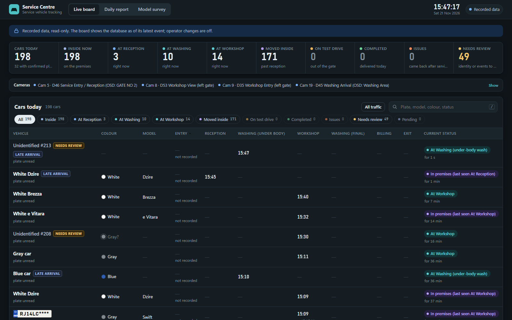
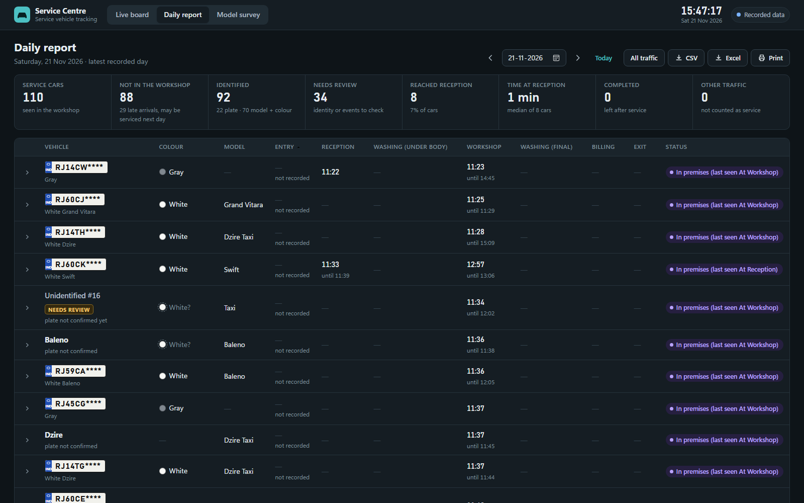

# Service Vehicle Tracking (SVT)

**Know where every service car is, from the gate to delivery, using the CCTV cameras a dealership already has.**

SVT is a computer-vision system for car service centres that I designed and built. It watches the existing CCTV cameras, recognises each car (number plate, model and colour) and follows it through the service journey. The service team sees on one live screen which car is where, how long each step has taken, and which cars are stuck.

It is built and tested at a working **Maruti Suzuki service centre** in India. Car model recognition covers the full Maruti line-up, and the system works with standard Hikvision-style NVRs. Nothing is installed in the cars.

> This repository is a project overview only. The source code, models and data are private.

---

## The problem

In a busy service centre, dozens of cars move every day between the gate, reception, washing, the workshop, billing and delivery. Today a car's status lives in people's heads, in phone calls, and in the job card system, which only knows what someone typed in. Managers cannot easily answer:

- Which cars are inside right now, and where are they?
- How long has this car been waiting at washing?
- Did this car really go through the workshop and the final wash before billing?
- How many cars came in today, and how many were delivered?

## What SVT does

| | |
|---|---|
| **Live board** | Every car on the premises with its current location and how long it has been there, plus counters for reception, washing, workshop and completed cars. |
| **Service journey** | Each car's journey step by step (Entry → Reception → Washing → Workshop → Test drive → Final wash → Billing → Exit), with the time of every step. |
| **Car identity** | Reads Indian number plates (including Bharat-series, EV and taxi plates) and recognises the car model and colour, so a car is followed even when its plate is not visible. |
| **Daily report** | Every service visit of the day with its journey times. It can be exported to CSV or Excel and printed. |
| **Review instead of guessing** | When the system is not sure (an unreadable plate, two similar white cars), it marks the car for review instead of making up an answer. Staff can correct a car in one click. |
| **Gets better with use** | Accuracy improves as the system runs on the site's own cameras. |

## Demo

*Number plates are masked in all screenshots and videos. Screenshots are from a live test day (21 Nov 2026) on four cameras: reception, two workshop cameras and washing.*

**Live dashboard (screen recording, 45 s):** [watch the video](img/live_dashboard.mp4)

**Live board:** the cars on the premises, their current step and the day's counters

**Daily report:** every service visit of the day with the time of each journey step, ready for export

## How it works (in short)

1. **Cameras in:** reads the existing NVR or IP camera streams (RTSP), live or from recordings.
2. **Detect and track:** finds the cars in every camera and follows them inside each view.
3. **Identify:** reads the number plate over many frames and recognises the car model and colour.
4. **Service logic:** turns sightings into service steps using the dealership's real workflow (reception, under-body wash, workshop, test drive, final wash, billing).
5. **Dashboard:** a web page on the local network with the live board, car details and the daily report.

Everything runs **on premises** on one PC. Video never leaves the dealership.

**Built with:** Python, PyTorch, computer vision (object detection, tracking, number plate recognition, image classification), FastAPI, SQLite, and a plain HTML/JavaScript dashboard.

## Results so far

Measured at a working service centre (held-out test cars the system had never seen, and live test days in November 2026):

- **Car model recognition: about 90 %** correct on 153 unseen cars (up from about 5 % for a model trained only on catalogue photos).
- **Live test days, checked by hand:** when the system is at least 60 % sure, the **car model was right 99 %** and the **colour 93 %** of the time.
- **Number plates:** on the hand-checked test day, no plate was ever confirmed wrongly. Unclear plates stay unconfirmed instead.
- **Live runs on the site's NVR:** reception, workshop and washing cameras tracked in real time; a full working day in the workshop (6+ hours, 4 cameras) ran without a single error.

## Scaling up

- **One site:** one desktop PC with an NVIDIA graphics card runs all of a site's service cameras.
- **More sites:** the same software and model can be used at another service centre. Mainly its service cameras need to be mapped.

## Status

A working prototype, tested on recorded and live footage at one Maruti Suzuki service centre. Next steps: run every camera live, follow each car's complete journey across all cameras, and add more locations.

## Contact

For a demo or a pilot at your service centre, message me on LinkedIn.

---

*Maruti Suzuki is a trademark of its owner. SVT is an independent project and is not affiliated with or endorsed by Maruti Suzuki India Ltd.*
